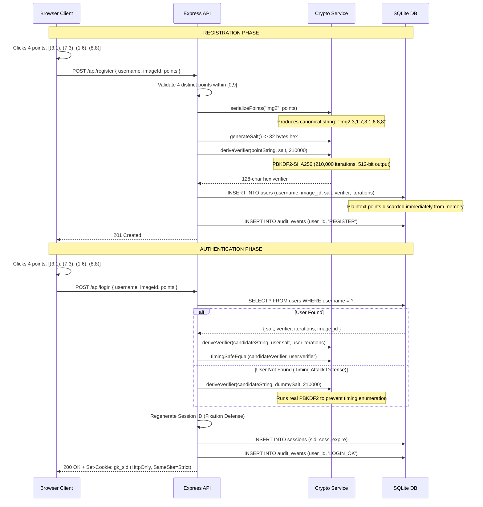
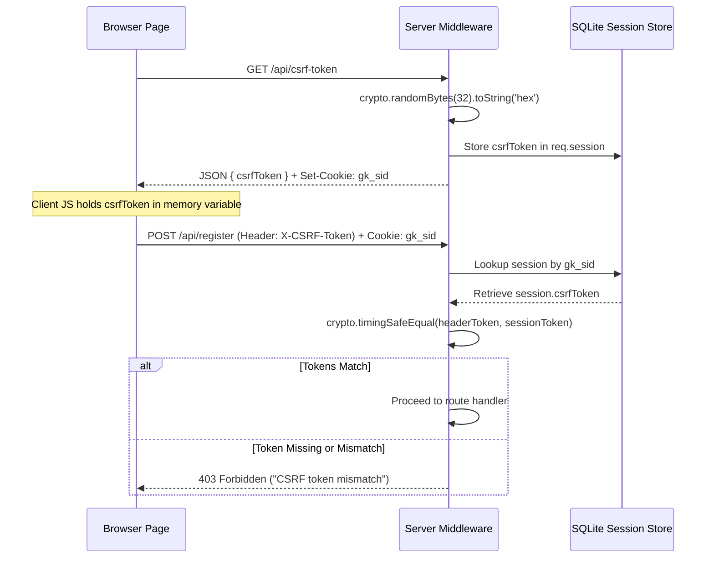

# GraphKey – System Architecture

## 1. Architectural Overview

GraphKey is structured as a layered, modular client-server application adhering to the **Separation of Concerns (SoC)** principle and defense-in-depth cybersecurity practices.

```
┌────────────────────────────────────────────────────────────────────────┐
│                          CLIENT TIER (Browser)                         │
│   HTML5 Canvas  ·  CSS3 Dark Theme  ·  Vanilla JS (No Frameworks)      │
└───────────────────────────────────┬────────────────────────────────────┘
                                    │ HTTP / HTTPS (REST API)
                                    │ JSON Payload + X-CSRF-Token
┌───────────────────────────────────▼────────────────────────────────────┐
│                         MIDDLEWARE PIPELINE                            │
│   Helmet Headers → JSON Parser → Session Store → CSRF Guard → Limiter  │
└───────────────────────────────────┬────────────────────────────────────┘
                                    │ Routed Requests
┌───────────────────────────────────▼────────────────────────────────────┐
│                         CONTROLLER & SERVICE TIER                      │
│   routes/auth.js   ·   services/crypto.js   ·   passwordService.js     │
└───────────────────────────────────┬────────────────────────────────────┘
                                    │ Prepared Parameterized Queries
┌───────────────────────────────────▼────────────────────────────────────┐
│                           DATA STORAGE TIER                            │
│          SQLite (better-sqlite3) with WAL Mode & Foreign Keys          │
│                users   ·   audit_events   ·   sessions                 │
└────────────────────────────────────────────────────────────────────────┘
```

---

## 2. The 10 × 10 Logical Grid Quantization Model

### The Challenge of Resolution Drift
In graphical password schemes, a user clicking on an image on a 1920×1080 desktop monitor will register different raw pixel offsets than when clicking the same visual feature on a 1366×768 laptop or mobile display. Storing absolute screen pixels causes immediate authentication failure on display resize or zoom.

### The Resolution-Independent Solution
GraphKey divides the displayed image into an invisible logical grid of **10 columns and 10 rows** ($10 \times 10 = 100$ discrete logical cells).

#### Coordinate Mapping Formula:
When a user clicks at physical display coordinates $(px, py)$ on an image of client display dimensions $(W, H)$:

$$\text{gridX} = \min\left(\left\lfloor \frac{px}{W} \times 10 \right\rfloor, 9\right)$$

$$\text{gridY} = \min\left(\left\lfloor \frac{py}{H} \times 10 \right\rfloor, 9\right)$$

Where:
- $px \in [0, W]$ and $py \in [0, H]$
- $\text{gridX} \in \{0, 1, 2, \dots, 9\}$
- $\text{gridY} \in \{0, 1, 2, \dots, 9\}$

```
 0    1    2    3    4    5    6    7    8    9
┌────┬────┬────┬────┬────┬────┬────┬────┬────┬────┐
│    │    │    │    │    │    │    │    │    │    │ 0
├────┼────┼────┼────┼────┼────┼────┼────┼────┼────┤
│    │    │    │(3,1)    │    │    │    │    │    │ 1  ← Point 1: Satellite
├────┼────┼────┼────┼────┼────┼────┼────┼────┼────┤
│    │    │    │    │    │    │    │    │    │    │ 2
├────┼────┼────┼────┼────┼────┼────┼────┼────┼────┤
│    │    │    │    │    │    │    │(7,3)    │    │ 3  ← Point 2: Planet Ring
├────┼────┼────┼────┼────┼────┼────┼────┼────┼────┤
│    │    │    │    │    │    │    │    │    │    │ 4
├────┼────┼────┼────┼────┼────┼────┼────┼────┼────┤
│    │    │    │    │    │    │    │    │    │    │ 5
├────┼────┼────┼────┼────┼────┼────┼────┼────┼────┤
│    │(1,6)    │    │    │    │    │    │    │    │ 6  ← Point 3: Crater
├────┼────┼────┼────┼────┼────┼────┼────┼────┼────┤
│    │    │    │    │    │    │    │    │    │    │ 7
├────┼────┼────┼────┼────┼────┼────┼────┼────┼────┤
│    │    │    │    │    │    │    │    │(8,8)    │ 8  ← Point 4: Distant Star
├────┼────┼────┼────┼────┼────┼────┼────┼────┼────┤
│    │    │    │    │    │    │    │    │    │    │ 9
└────┴────┴────┴────┴────┴────┴────┴────┴────┴────┘
```

### Advantages:
1. **Resolution Independence**: The user can register on a desktop and log in on a mobile screen or zoomed browser window; as long as they click the same visual feature, the logical cell remains identical.
2. **Tolerance Window**: Minor mouse tremors or touch drift within the same cell do not cause false rejects.
3. **Finite Search Space**: There are $\frac{100!}{(100-4)!} = 94,109,400$ ordered point permutations per image, preventing trivial guessing while remaining memorable.

---

## 3. Cryptographic Pipeline



---

## 4. Double-Submit CSRF Defense Flow

To guard state-changing endpoints against Cross-Site Request Forgery (CSRF):



---

## 5. Session Architecture & Persistence

Unlike the vulnerable default Express `MemoryStore` (which leaks memory and loses all active logins on restart):
- **Store Implementation**: `better-sqlite3-session-store` writes session objects directly to a dedicated `sessions` table in `graphkey.db`.
- **Sliding Expiration**: Configured with `rolling: true` and a 30-minute idle TTL (`maxAge: 30 * 60 * 1000`).
- **Session Cleanup**: Expired session rows are purged every 15 minutes automatically.
- **Session Fixation Prevention**: `req.session.regenerate()` is called upon successful authentication, replacing pre-login session IDs with a freshly generated authenticated session ID.
