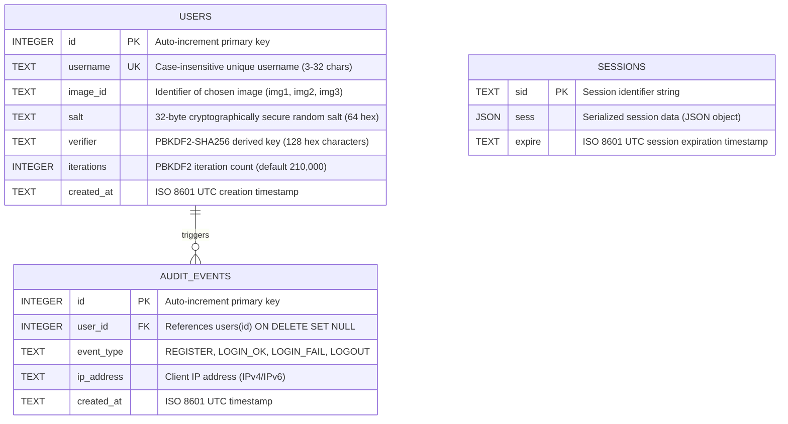

# GraphKey – Database Documentation

## 1. Database Architecture

GraphKey uses **SQLite** via the synchronous, native C++ driver **`better-sqlite3`**.

- **File Location**: `data/graphkey.db`
- **Driver**: `better-sqlite3` (v13.0+)
- **Integrity & Concurrency Pragmas**:
  ```sql
  PRAGMA journal_mode = WAL;       -- Write-Ahead Logging for concurrent reads & fast writes
  PRAGMA foreign_keys = ON;        -- Enforce referential integrity
  PRAGMA synchronous = NORMAL;     -- Optimal safety & performance trade-off with WAL
  ```

---

## 2. Entity-Relationship (ER) Diagram



---

## 3. Data Dictionary

### Table: `users`
Stores registered user credentials. **Never stores plaintext passwords, raw click coordinates, or graphical points.**

| Column | Type | Constraints | Description |
|---|---|---|---|
| `id` | `INTEGER` | `PRIMARY KEY AUTOINCREMENT` | Unique identifier for each user. |
| `username` | `TEXT` | `NOT NULL UNIQUE COLLATE NOCASE` | User login handle (3–32 chars, `[a-zA-Z0-9_]`). Case-insensitive. |
| `image_id` | `TEXT` | `NOT NULL` | ID of the predefined image chosen during registration (`img1`, `img2`, `img3`). |
| `salt` | `TEXT` | `NOT NULL` | Cryptographically random 32-byte salt generated via `crypto.randomBytes(32)` (64 hex characters). |
| `verifier` | `TEXT` | `NOT NULL` | 512-bit PBKDF2-SHA256 password hash output (128 hex characters). |
| `iterations` | `INTEGER` | `NOT NULL` | Number of PBKDF2 rounds used during derivation (e.g., 210,000). |
| `created_at` | `TEXT` | `NOT NULL DEFAULT (datetime('now'))` | ISO 8601 creation timestamp. |

### Table: `audit_events`
Maintains a security log of all authentication actions. **Never logs sensitive credentials, passwords, salts, or session IDs.**

| Column | Type | Constraints | Description |
|---|---|---|---|
| `id` | `INTEGER` | `PRIMARY KEY AUTOINCREMENT` | Unique audit log event ID. |
| `user_id` | `INTEGER` | `NULLABLE, FK -> users(id) ON DELETE SET NULL` | ID of the affected user, or `NULL` if login failed for unknown user. |
| `event_type` | `TEXT` | `NOT NULL` | Action code: `REGISTER`, `LOGIN_OK`, `LOGIN_FAIL`, `LOGOUT`. |
| `ip_address` | `TEXT` | `NULLABLE` | Client IPv4 or IPv6 address making the request. |
| `created_at` | `TEXT` | `NOT NULL DEFAULT (datetime('now'))` | ISO 8601 timestamp of event occurrence. |

### Table: `sessions`
Managed automatically by `better-sqlite3-session-store` to replace transient in-memory session tracking.

| Column | Type | Constraints | Description |
|---|---|---|---|
| `sid` | `TEXT` | `NOT NULL PRIMARY KEY` | Session ID matching the signed `gk_sid` client cookie. |
| `sess` | `JSON` | `NOT NULL` | Serialized session object containing `userId`, `username`, and `csrfToken`. |
| `expire` | `TEXT` | `NOT NULL` | Expiry timestamp used for rolling expiration and automated cleanup. |

---

## 4. Database Indexes

To maintain sub-millisecond query performance and ensure constraint integrity:

| Index Name | Table | Columns | Purpose |
|---|---|---|---|
| `sqlite_autoindex_users_1` | `users` | `username` | Enforces uniqueness constraint on usernames. |
| `idx_users_username` | `users` | `username COLLATE NOCASE` | Accelerated case-insensitive lookups on login. |
| `idx_audit_user_id` | `audit_events` | `user_id` | Fast historical query lookups of a user's login events. |
| `sqlite_autoindex_sessions_1` | `sessions` | `sid` | Primary key index for rapid session retrieval on every incoming request. |

---

## 5. Zero-Knowledge Forensic Verification Proof

To demonstrate to examiners that graphical password coordinates are **never stored**:

### Query Sample:
```sql
SELECT id, username, image_id, salt, verifier, iterations FROM users;
```

### Forensic Result:
```
id        : 1
username  : alice_cyber
image_id  : img2
salt      : 7b848c08de5df4c1a70da729a4bb380bf9cf8dd8ef0ea8fa7bca06122588f01f (64 chars)
verifier  : a9c298fe24a0d8e48d3d95bce1301c3c9b7754d9241b7dd4812a321cfba18ff7... (128 chars)
iterations: 210000
```

1. **Absence of Point Columns**: The schema contains no `points`, `coordinates`, or `raw_password` columns.
2. **One-Way Cryptographic Derivation**: The verifier is generated from `crypto.pbkdf2(pointString, salt, 210000, 64, 'sha256')`. Because SHA-256 is a one-way preimage-resistant cryptographic hash function, mathematically recovering the four clicked grid coordinates from the 128-character verifier is computationally infeasible.
3. **Database Theft Defense**: Even if an attacker compromises the complete database file (`graphkey.db`), they obtain only irreversible salted hashes.
